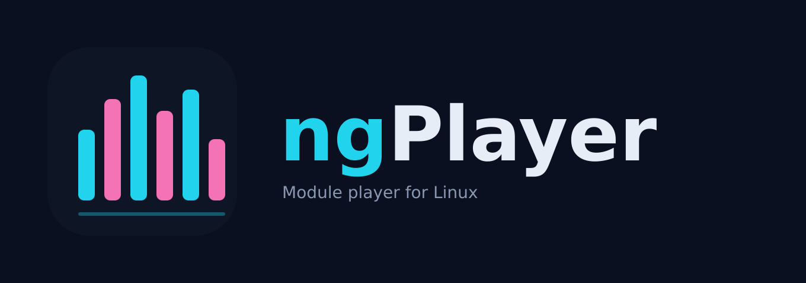

<p align="center"></p>

# ngPlayer

A fast, good-looking module player for Linux with a GPU-rendered interface: per-voice oscilloscopes, realtime
panning and buttery-smooth pattern scrolling.


## Why

ngPlayer is inspired by the great **XTC-Play** module player by Sanction. Back in the DOS days, players like it
on a Gravis UltraSound (and UltraSound PnP) set the bar for how tracker music could sound. I wanted that same
level of quality on Linux, together with an interface that is a joy to look at.

## Supported formats

| Format | Status |
| --- | --- |
| MOD (ProTracker and compatibles) | supported |
| S3M (Scream Tracker 3) | supported |
| STM (Scream Tracker 2) | supported (4 channels, played through the S3M engine) |
| PTM (Poly Tracker) | supported (1-32 channels, 16-bit samples, played through the S3M engine) |
| ULT (UltraTracker) | supported (1-32 channels, 8/16-bit samples, played through the S3M engine) |
| 669 (Composer 669 / UNIS 669) | supported (8 channels, linear-frequency slides, played through the S3M engine) |
| MTM (MultiTracker) | supported (1-32 channels, played through the MOD engine) |
| XM (FastTracker 2) | supported |
| IT (Impulse Tracker) | supported, still being completed |
| DMF (X-Tracker, v8) | supported, some rare effects still missing |
| TFMX (Chris Hülsbeck, `mdat.NAME` + `smpl.NAME` or `NAME.tfx` + `NAME.sam`) | supported (subsong 0, no pattern view yet) |

Looking for DMF files to try? The [Radical Rhythms Archive](https://www.radicalrhythms.org/) collects tracks by a German tracker group from the mid-1990s, including DMF modules.

Planned: MDL, DSM, FAR, 15-sample MOD, WAV/VOC, MP1/MP2/MP3.

## Features

- Pattern view with **all channels**: notes, instruments, volume column and colour-coded effects
- **Oscilloscope per voice** and **realtime panning** in every channel header
- Channel overview: volume bars with peak hold, last note, effect name and panning per channel
- Time-continuous scrolling locked to the audio clock, drawn at the full refresh rate of your monitor
- Spectrum analyser and level meters
- Seek inside a song (Left/Right), drag and drop for files and folders, playlist

## Technical details

- Written in C. The replayer and mixer are independent of the interface; one loader and replayer per format
  behind a common song layer.
- Replayer behaviour is checked against reference renders with an automated regression suite.
- Interface: SDL2 for window, input and audio, **OpenGL 3.3** for drawing. A batched renderer draws rounded
  rectangles via signed distance fields, glow, polylines and a baked glyph atlas from a single vertex buffer.
- The audio thread renders in short slices and reports every row change with its sample position, so the
  display scrolls exactly in time with what you hear.

## Install

Download the latest `ngPlayer-*-x86_64.AppImage` from the [Releases](../../releases) page:

```sh
chmod +x ngPlayer-*-x86_64.AppImage
./ngPlayer-*-x86_64.AppImage ~/Music/modules
```

## Build from source

Requirements: `gcc`, `make`, SDL2 development files (Arch/CachyOS: `sudo pacman -S sdl2`,
Debian/Ubuntu: `sudo apt install libsdl2-dev`).

```sh
make
./build/ngplayer path/to/files-or-folders
```

Build an AppImage yourself: `sh packaging/build-appimage.sh`.

## Keys

| Key | Action |
| --- | --- |
| Space | Pause / play |
| Left / Right | Seek to previous / next order in the song |
| Up / Down | Previous / next file |
| Shift + Left / Right, mouse wheel | Scroll channels |
| R | Restart song |
| F / F11 | Fullscreen |
| F5 / F6 | Audio/video sync trim (±5 ms) |
| Esc | Quit |

## Status

ngPlayer is young. Playback is regression-tested against reference renders; known deviations and open items
are tracked in the issue tracker. Planned: more formats, online browser for [The Mod Archive](https://modarchive.org/),
per-channel mute/solo, interpolation and filter options.

## License

GPL-3.0-or-later, see [LICENSE](LICENSE). Third-party components: [THIRD_PARTY.md](THIRD_PARTY.md).
