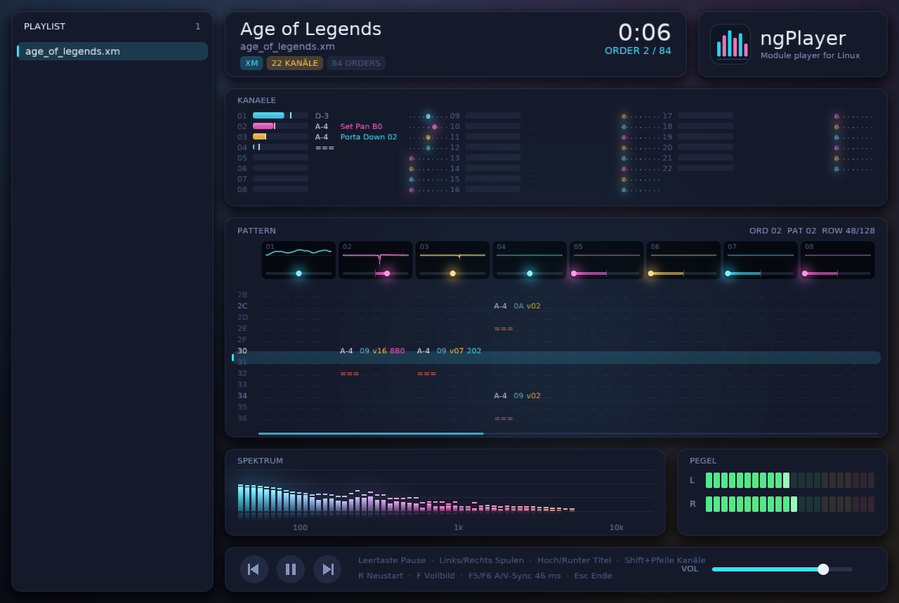

<p align="center"></p>

# ngPlayer

A fast, good-looking module player for Linux. Plays **MOD, S3M, XM and IT** with a replayer that follows the
behaviour of the classic DOS players, and a GPU-rendered (SDL2 + OpenGL 3.3) interface in the style of
[ngSid](https://github.com/darkVamp76).



## Features

- MOD, S3M, XM and IT playback (IT with NNA, envelopes, filters, volume column)
- Pattern view with **all channels**, notes, instruments, volume column and colour-coded effects
- **Oscilloscope per voice** and **realtime panning** in every channel header
- Channel overview: volume bars with peak hold, last note, effect name and panning per channel
- Butter-smooth, time-continuous scrolling locked to the audio clock (runs at full monitor refresh rate)
- Spectrum analyser and level meters
- Seek inside a song (Left/Right), drag & drop files and folders, playlist

## Install

Download the latest `ngPlayer-*-x86_64.AppImage` from the [Releases](../../releases) page:

```sh
chmod +x ngPlayer-*-x86_64.AppImage
./ngPlayer-*-x86_64.AppImage ~/Music/modules
```

## Build from source

Requirements: `gcc`, `make`, SDL2 development files (Arch/CachyOS: `sudo pacman -S sdl2`,
Debian/Ubuntu: `sudo apt install libsdl2-dev`).

```sh
make
./build/ngplayer path/to/files-or-folders
```

Build an AppImage yourself: `sh packaging/build-appimage.sh`.

## Keys

| Key | Action |
| --- | --- |
| Space | Pause / play |
| Left / Right | Seek to previous / next order in the song |
| Up / Down | Previous / next file |
| Shift + Left / Right, mouse wheel | Scroll channels |
| R | Restart song |
| F / F11 | Fullscreen |
| F5 / F6 | Audio/video sync trim (±5 ms) |
| Esc | Quit |

## Status

ngPlayer is young. Playback is regression-tested against reference renders; known deviations and open items
are tracked in the issue tracker. Planned: more formats, online browser for [The Mod Archive](https://modarchive.org/),
per-channel mute/solo, interpolation and filter options.

## License

GPL-3.0-or-later, see [LICENSE](LICENSE). Third-party components: [THIRD_PARTY.md](THIRD_PARTY.md).
